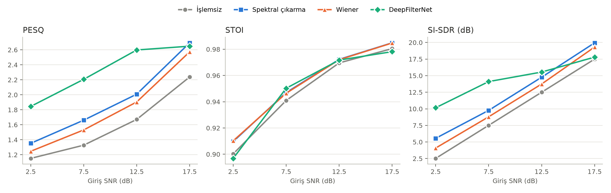
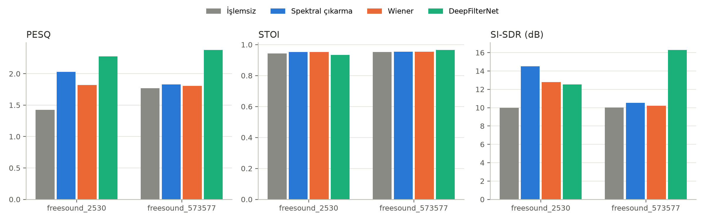

> Not: Bu sonuçlar DeepFilterNet örnek kayıtlarından üretilmiş 24 kayıtlık sentetik bir deneme kümesine aittir; boru hattının çalıştığını göstermek içindir, gerçek VoiceBank-DEMAND sonucu değildir.

# Karşılaştırmalı Analiz Özeti

Kayıt sayısı: 24, yöntemler: İşlemsiz, Spektral çıkarma, Wiener, DeepFilterNet

## Yöntem başına ortalama ± std

| method           | PESQ          | STOI          | SI-SDR (dB)    |
|:-----------------|:--------------|:--------------|:---------------|
| İşlemsiz         | 1.597 ± 0.528 | 0.948 ± 0.038 | 10.010 ± 5.700 |
| Spektral çıkarma | 1.929 ± 0.558 | 0.953 ± 0.035 | 12.509 ± 6.098 |
| Wiener           | 1.814 ± 0.546 | 0.953 ± 0.035 | 11.486 ± 6.028 |
| DeepFilterNet    | 2.325 ± 0.524 | 0.949 ± 0.055 | 14.404 ± 4.807 |

## İşlemsiz kayda göre ortalama iyileşme

| Yöntem           |   Δ PESQ |   Δ STOI |   Δ SI-SDR (dB) |
|:-----------------|---------:|---------:|----------------:|
| Spektral çıkarma |    0.332 |    0.006 |           2.5   |
| Wiener           |    0.217 |    0.006 |           1.476 |
| DeepFilterNet    |    0.727 |    0.001 |           4.394 |

## Eşleştirilmiş Wilcoxon testi

| Karşılaştırma                     | Ölçüt       |   Ortalama fark |   n |   p (Wilcoxon) |
|:----------------------------------|:------------|----------------:|----:|---------------:|
| DeepFilterNet vs İşlemsiz         | PESQ        |           0.727 |  24 |      1.192e-06 |
| DeepFilterNet vs İşlemsiz         | STOI        |           0.001 |  24 |      0.2292    |
| DeepFilterNet vs İşlemsiz         | SI-SDR (dB) |           4.394 |  24 |      0.0002781 |
| DeepFilterNet vs Spektral çıkarma | PESQ        |           0.396 |  24 |      0.0004299 |
| DeepFilterNet vs Spektral çıkarma | STOI        |          -0.004 |  24 |      0.9664    |
| DeepFilterNet vs Spektral çıkarma | SI-SDR (dB) |           1.894 |  24 |      0.2405    |
| DeepFilterNet vs Wiener           | PESQ        |           0.511 |  24 |      1.311e-05 |
| DeepFilterNet vs Wiener           | STOI        |          -0.004 |  24 |      0.8996    |
| DeepFilterNet vs Wiener           | SI-SDR (dB) |           2.918 |  24 |      0.01787   |

## SNR seviyesine göre ortalama PESQ

|   snr |   İşlemsiz |   Spektral çıkarma |   Wiener |   DeepFilterNet |
|------:|-----------:|-------------------:|---------:|----------------:|
|   2.5 |      1.152 |              1.353 |    1.247 |           1.845 |
|   7.5 |      1.328 |              1.662 |    1.531 |           2.207 |
|  12.5 |      1.671 |              2.008 |    1.904 |           2.598 |
|  17.5 |      2.238 |              2.694 |    2.574 |           2.649 |

