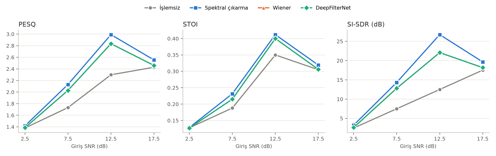
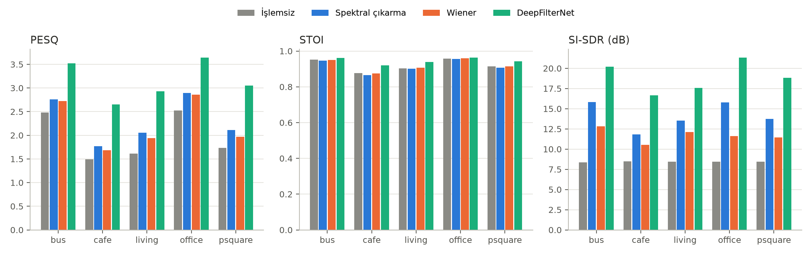

# Karşılaştırmalı Analiz Özeti

Kayıt sayısı: 824, yöntemler: İşlemsiz, Spektral çıkarma, Wiener, DeepFilterNet

## Yöntem başına ortalama ± std

| method           | PESQ          | STOI          | SI-SDR (dB)    |
|:-----------------|:--------------|:--------------|:---------------|
| İşlemsiz         | 1.967 ± 0.752 | 0.921 ± 0.071 | 8.446 ± 5.618  |
| Spektral çıkarma | 2.315 ± 0.721 | 0.915 ± 0.076 | 14.135 ± 4.975 |
| Wiener           | 2.233 ± 0.773 | 0.921 ± 0.072 | 11.707 ± 5.585 |
| DeepFilterNet    | 3.159 ± 0.646 | 0.945 ± 0.050 | 18.918 ± 3.408 |

## İşlemsiz kayda göre ortalama iyileşme

| Yöntem           |   Δ PESQ |   Δ STOI |   Δ SI-SDR (dB) |
|:-----------------|---------:|---------:|----------------:|
| Spektral çıkarma |    0.348 |   -0.007 |           5.69  |
| Wiener           |    0.265 |    0     |           3.262 |
| DeepFilterNet    |    1.192 |    0.024 |          10.472 |

## Eşleştirilmiş Wilcoxon testi

| Karşılaştırma                     | Ölçüt       |   Ortalama fark |   n |   p (Wilcoxon) |
|:----------------------------------|:------------|----------------:|----:|---------------:|
| DeepFilterNet vs İşlemsiz         | PESQ        |           1.192 | 824 |     1.731e-136 |
| DeepFilterNet vs İşlemsiz         | STOI        |           0.024 | 824 |     3.477e-89  |
| DeepFilterNet vs İşlemsiz         | SI-SDR (dB) |          10.47  | 824 |     1.842e-136 |
| DeepFilterNet vs Spektral çıkarma | PESQ        |           0.844 | 824 |     3.79e-135  |
| DeepFilterNet vs Spektral çıkarma | STOI        |           0.031 | 824 |     9.008e-105 |
| DeepFilterNet vs Spektral çıkarma | SI-SDR (dB) |           4.783 | 824 |     6.66e-133  |
| DeepFilterNet vs Wiener           | PESQ        |           0.927 | 824 |     2.681e-136 |
| DeepFilterNet vs Wiener           | STOI        |           0.024 | 824 |     2.933e-86  |
| DeepFilterNet vs Wiener           | SI-SDR (dB) |           7.211 | 824 |     1.1e-134   |

## SNR seviyesine göre ortalama PESQ

|   snr |   İşlemsiz |   Spektral çıkarma |   Wiener |   DeepFilterNet |
|------:|-----------:|-------------------:|---------:|----------------:|
|   2.5 |      1.419 |              1.733 |    1.614 |           2.592 |
|   7.5 |      1.76  |              2.161 |    2.076 |           3.104 |
|  12.5 |      2.099 |              2.456 |    2.382 |           3.322 |
|  17.5 |      2.599 |              2.919 |    2.867 |           3.625 |

