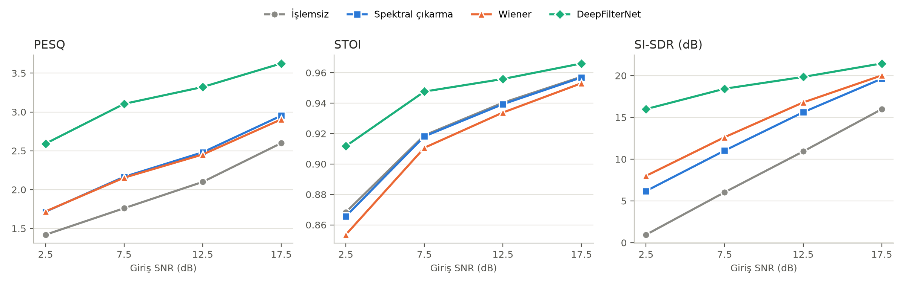
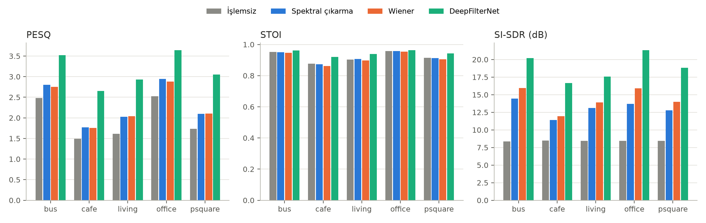

# Karşılaştırmalı Analiz Özeti

Kayıt sayısı: 824, yöntemler: İşlemsiz, Spektral çıkarma, Wiener, DeepFilterNet

## Yöntem başına ortalama ± std

| method           | PESQ          | STOI          | SI-SDR (dB)    |
|:-----------------|:--------------|:--------------|:---------------|
| İşlemsiz         | 1.967 ± 0.752 | 0.921 ± 0.071 | 8.446 ± 5.618  |
| Spektral çıkarma | 2.326 ± 0.755 | 0.920 ± 0.073 | 13.089 ± 5.352 |
| Wiener           | 2.306 ± 0.723 | 0.913 ± 0.077 | 14.339 ± 5.143 |
| DeepFilterNet    | 3.159 ± 0.646 | 0.945 ± 0.050 | 18.918 ± 3.408 |

## İşlemsiz kayda göre ortalama iyileşme

| Yöntem           |   Δ PESQ |   Δ STOI |   Δ SI-SDR (dB) |
|:-----------------|---------:|---------:|----------------:|
| Spektral çıkarma |    0.359 |   -0.001 |           4.644 |
| Wiener           |    0.338 |   -0.008 |           5.894 |
| DeepFilterNet    |    1.192 |    0.024 |          10.472 |

## Eşleştirilmiş Wilcoxon testi

| Karşılaştırma                     | Ölçüt       |   Ortalama fark |   n |   p (Wilcoxon) |
|:----------------------------------|:------------|----------------:|----:|---------------:|
| DeepFilterNet vs İşlemsiz         | PESQ        |           1.192 | 824 |     1.731e-136 |
| DeepFilterNet vs İşlemsiz         | STOI        |           0.024 | 824 |     3.477e-89  |
| DeepFilterNet vs İşlemsiz         | SI-SDR (dB) |          10.47  | 824 |     1.842e-136 |
| DeepFilterNet vs Spektral çıkarma | PESQ        |           0.833 | 824 |     4.56e-135  |
| DeepFilterNet vs Spektral çıkarma | STOI        |           0.025 | 824 |     8.385e-91  |
| DeepFilterNet vs Spektral çıkarma | SI-SDR (dB) |           5.829 | 824 |     6.232e-133 |
| DeepFilterNet vs Wiener           | PESQ        |           0.854 | 824 |     3.412e-135 |
| DeepFilterNet vs Wiener           | STOI        |           0.033 | 824 |     6.488e-109 |
| DeepFilterNet vs Wiener           | SI-SDR (dB) |           4.579 | 824 |     4.391e-131 |

## SNR seviyesine göre ortalama PESQ

|   snr |   İşlemsiz |   Spektral çıkarma |   Wiener |   DeepFilterNet |
|------:|-----------:|-------------------:|---------:|----------------:|
|   2.5 |      1.419 |              1.716 |    1.72  |           2.592 |
|   7.5 |      1.76  |              2.165 |    2.154 |           3.104 |
|  12.5 |      2.099 |              2.48  |    2.452 |           3.322 |
|  17.5 |      2.599 |              2.952 |    2.905 |           3.625 |

