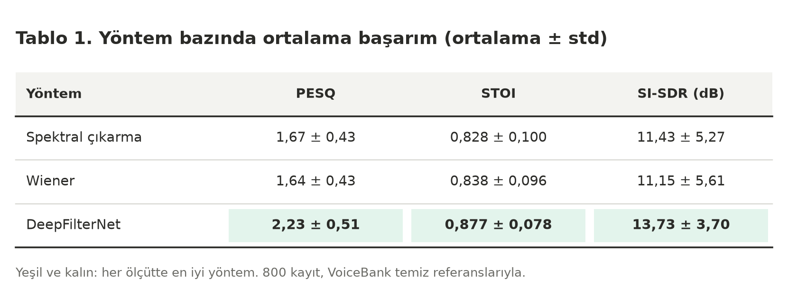
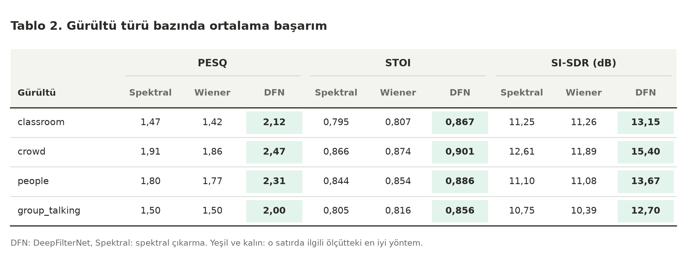
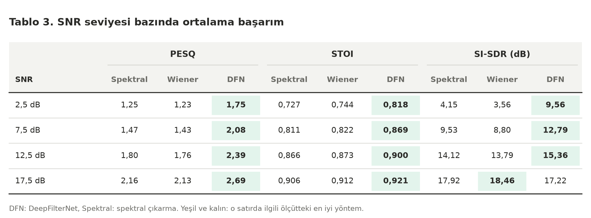
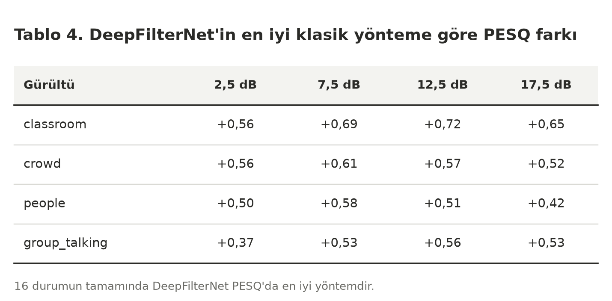
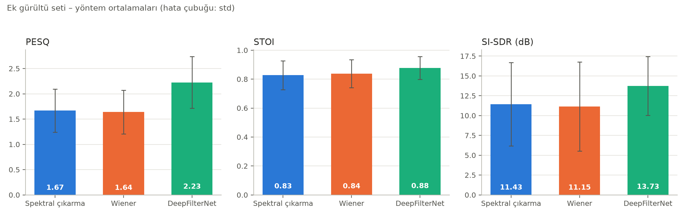
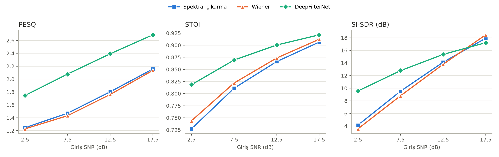
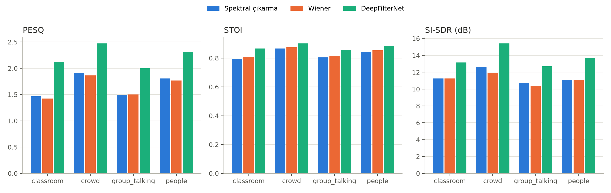

# Ek Gürültü Deneyi – Metrik Analizi

800 kayıt · gürültüler: classroom, crowd, people, group_talking · SNR: 2.5, 7.5, 12.5, 17.5 dB · yöntemler: Spektral çıkarma, Wiener, DeepFilterNet

## Yöntem bazında (ortalama ± std)

|                  | PESQ          | STOI          | SI-SDR (dB)    |
|:-----------------|:--------------|:--------------|:---------------|
| Spektral çıkarma | 1.669 ± 0.427 | 0.828 ± 0.100 | 11.428 ± 5.268 |
| Wiener           | 1.639 ± 0.431 | 0.838 ± 0.096 | 11.154 ± 5.610 |
| DeepFilterNet    | 2.226 ± 0.509 | 0.877 ± 0.078 | 13.729 ± 3.701 |

## Gürültü türü bazında (ortalama)

**PESQ**

| Gürültü       |   Spektral çıkarma |   Wiener |   DeepFilterNet |
|:--------------|-------------------:|---------:|----------------:|
| classroom     |              1.467 |    1.422 |           2.124 |
| crowd         |              1.907 |    1.863 |           2.471 |
| people        |              1.805 |    1.768 |           2.308 |
| group_talking |              1.496 |    1.503 |           2.001 |

**STOI**

| Gürültü       |   Spektral çıkarma |   Wiener |   DeepFilterNet |
|:--------------|-------------------:|---------:|----------------:|
| classroom     |              0.795 |    0.807 |           0.867 |
| crowd         |              0.866 |    0.874 |           0.901 |
| people        |              0.844 |    0.854 |           0.886 |
| group_talking |              0.805 |    0.816 |           0.856 |

**SI-SDR (dB)**

| Gürültü       |   Spektral çıkarma |   Wiener |   DeepFilterNet |
|:--------------|-------------------:|---------:|----------------:|
| classroom     |             11.247 |   11.258 |          13.148 |
| crowd         |             12.611 |   11.893 |          15.397 |
| people        |             11.099 |   11.079 |          13.668 |
| group_talking |             10.754 |   10.387 |          12.705 |

## SNR bazında (ortalama)

**PESQ**

|   SNR (dB) |   Spektral çıkarma |   Wiener |   DeepFilterNet |
|-----------:|-------------------:|---------:|----------------:|
|        2.5 |              1.246 |    1.228 |           1.746 |
|        7.5 |              1.47  |    1.432 |           2.078 |
|       12.5 |              1.803 |    1.761 |           2.392 |
|       17.5 |              2.156 |    2.134 |           2.687 |

**STOI**

|   SNR (dB) |   Spektral çıkarma |   Wiener |   DeepFilterNet |
|-----------:|-------------------:|---------:|----------------:|
|        2.5 |              0.727 |    0.744 |           0.818 |
|        7.5 |              0.811 |    0.822 |           0.869 |
|       12.5 |              0.866 |    0.873 |           0.9   |
|       17.5 |              0.906 |    0.912 |           0.921 |

**SI-SDR (dB)**

|   SNR (dB) |   Spektral çıkarma |   Wiener |   DeepFilterNet |
|-----------:|-------------------:|---------:|----------------:|
|        2.5 |              4.146 |    3.56  |           9.558 |
|        7.5 |              9.526 |    8.802 |          12.787 |
|       12.5 |             14.119 |   13.793 |          15.356 |
|       17.5 |             17.92  |   18.461 |          17.216 |

## Her gürültü × SNR hücresinde PESQ'ya göre en iyi yöntem

| noise_type    | 2.5           | 7.5           | 12.5          | 17.5          |
|:--------------|:--------------|:--------------|:--------------|:--------------|
| classroom     | DeepFilterNet | DeepFilterNet | DeepFilterNet | DeepFilterNet |
| crowd         | DeepFilterNet | DeepFilterNet | DeepFilterNet | DeepFilterNet |
| people        | DeepFilterNet | DeepFilterNet | DeepFilterNet | DeepFilterNet |
| group_talking | DeepFilterNet | DeepFilterNet | DeepFilterNet | DeepFilterNet |

## DeepFilterNet – en iyi klasik yöntem (PESQ farkı)

| noise_type    |   2.5 |   7.5 |   12.5 |   17.5 |
|:--------------|------:|------:|-------:|-------:|
| classroom     | 0.564 | 0.694 |  0.718 |  0.652 |
| crowd         | 0.557 | 0.612 |  0.568 |  0.519 |
| people        | 0.497 | 0.582 |  0.508 |  0.425 |
| group_talking | 0.365 | 0.532 |  0.56  |  0.528 |

## Eşleştirilmiş Wilcoxon testi

| Karşılaştırma                     | Ölçüt       |   Ortalama fark |   n |   p (Wilcoxon) |
|:----------------------------------|:------------|----------------:|----:|---------------:|
| DeepFilterNet vs Spektral çıkarma | PESQ        |           0.557 | 800 |     6.39e-130  |
| DeepFilterNet vs Spektral çıkarma | STOI        |           0.05  | 800 |     7.499e-109 |
| DeepFilterNet vs Spektral çıkarma | SI-SDR (dB) |           2.302 | 800 |     1.428e-66  |
| DeepFilterNet vs Wiener           | PESQ        |           0.587 | 800 |     3.898e-131 |
| DeepFilterNet vs Wiener           | STOI        |           0.04  | 800 |     1.962e-95  |
| DeepFilterNet vs Wiener           | SI-SDR (dB) |           2.575 | 800 |     1.698e-65  |

## Tablo görüntüleri

## Grafikler

